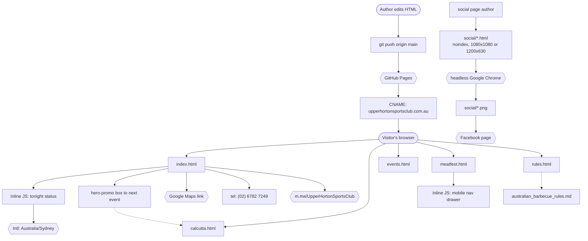

# Architecture

The site is five static HTML files served by GitHub Pages, behind a custom domain. There is no
build step, no framework, no bundler and no server-side code — `git push` is the whole deploy
pipeline. Each page carries its own inline `<style>` block and, where needed, an inline
`<script>`; there is no shared stylesheet.

That means **CSS is duplicated across pages**. Colour tokens (`--primary`, `--accent`,
`--amber`, `--gold`, `--bg-dark`, …) are redefined in each page's `:root`. Changing a token on
one page does not change it on the others — see the checklist in
[content-editing.md](content-editing.md). `--gold` exists only on `calcutta.html` and on the
social templates; the rest of the site is blue/orange.

There are two output pipelines, and it matters which one a file belongs to:

1. **Pages** — `*.html` at the repo root. Served by Pages, read by visitors.
2. **Graphics** — `social/*.html`, `noindex`, never read by a visitor. Screenshotted to PNG by
   headless Chrome. See [social-graphics.md](social-graphics.md).

## Components

- **GitHub Pages** — serves the repo's `main` branch over HTTPS. Rebuilds in roughly 1–2
  minutes after a push. No CI workflow is required for a static site.
- **`CNAME`** — pins the custom domain `upperhortonsportsclub.com.au`. Requests to
  `hawkinle.github.io` 301-redirect to it.
- **`index.html`** — homepage. Carries the only stateful code on the site: the inline
  "Tonight at the Club" status script (below), followed by the hero promo box that links to
  whichever event is next.
- **`calcutta.html`** — the Melbourne Cup Calcutta event page. Same self-contained pattern as the
  others, but themed with `--gold` rather than the site's orange. This is the page the homepage's
  `.hero-promo` box and "What's on" card both point at.
- **`events.html`, `meatfest.html`, `rules.html`** — static content pages, each self-contained.
  `meatfest.html` carries one small script, the mobile nav drawer toggle — see below.
- **`social/`** — graphics templates. `noindex`, not in the sitemap, rendered to PNG. Not part of
  the visitor-facing site, but served from the same domain.
- **`_config.yml`** — Jekyll config. It declares `theme: jekyll-theme-cayman`, which is **never
  applied** — no page uses a Jekyll layout. The HTML files are served **verbatim** because none
  of them have YAML front matter; Jekyll copies them through untouched. The config is therefore
  inert for these pages, but is kept tidy and carries the club name/description for the record.

## System Diagram

## Data Flow — the homepage "tonight" status

`index.html` contains one inline IIFE at the end of `<body>`. On load it:

1. Reads the current date/time **in the club's timezone** (`Australia/Sydney`) via
   `Intl.DateTimeFormat(...).formatToParts()`. Using the club timezone, not the visitor's, means
   a traveller sees the club's real state.
2. Works out whether NSW daylight saving is active, using the "first Sunday in October →
   first Sunday in April" rule.
3. Looks the day up in a small in-file schedule table and writes one of three states into the
   card: *Closed today*, *Opens today/tonight at X*, or *Open now*.
4. Adds `.today` to the matching row in the hours list so today is highlighted.

The schedule table maps **opening times only**. It deliberately has no `close` field — closing
is patronage-dependent. See [content-editing.md](content-editing.md) before touching it.

`aria-live="polite"` is set on the card so the status is announced to screen readers after the
script runs.

## Data Flow — the Meat Fest mobile nav drawer

`meatfest.html` is the only page with a nav drawer. Its script is trivial and has one trap:
`mobile-toggle` only ever **adds** the `.open` class on click and removes it when a link inside the
drawer is followed. There is no click-outside-to-close and no Escape handler, so the drawer stays
open until a link is clicked. If you add a close button, wire it to `classList.remove('open')` —
not to a toggle, or you double-toggle against the link handler.

## Data Flow — social graphics

Separate pipeline, no server involvement: `social/*.html` → headless Chrome screenshot →
`social/*.png` → posted to Facebook. The output size comes from Chrome's `--window-size`, not from
CSS, which is why the two must be kept in step. Full detail in
[social-graphics.md](social-graphics.md).

## Key Design Decisions

- **Utility first.** The page leads with open-tonight status, phone and address. Events come
  after. This was a deliberate change from the original design, which led with whatever event
  was happening and buried the phone number two screens down.
- **No hard closing times anywhere** — not in the HTML, and not in the structured data. The
  `openingHoursSpecification` in the JSON-LD block carries `opens` but **no `closes`**, so a
  Google result can never claim the club closes at a time it doesn't.
- **Archive, don't delete.** Meat Fest 2026 is kept as a dated archive page. The rule applied on
  the homepage is that nothing leads with a date in the past.
- **The next event gets the hero, and the hero is a link.** The `.hero-promo` box at the top of
  the homepage is an `<a>`, not a banner — its whole job is to send people to the event page
  (`calcutta.html` while the Calcutta is next). When the event changes, repoint that one link and
  rewrite its three spans; don't add a second promo box.
- **Graphics are generated, not drawn.** The Facebook posts are HTML screenshotted to PNG, so the
  wording is version-controlled with the site and the club's real typefaces are used. See
  [social-graphics.md](social-graphics.md).
- **Serve the club name once.** The site's hero uses `images/hero_banner.jpg`, not
  `images/banner.jpg` — see the hero warning in [content-editing.md](content-editing.md).
- **Structured data is real.** The JSON-LD `SportsActivityLocation` block on the homepage
  duplicates the address, geo coordinates, phone and hours that appear in the visible copy, so
  search engines and the page agree.
