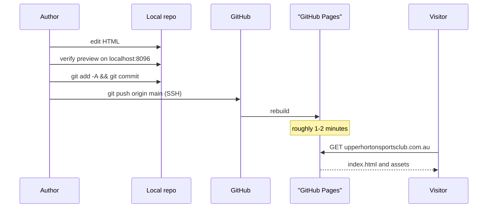
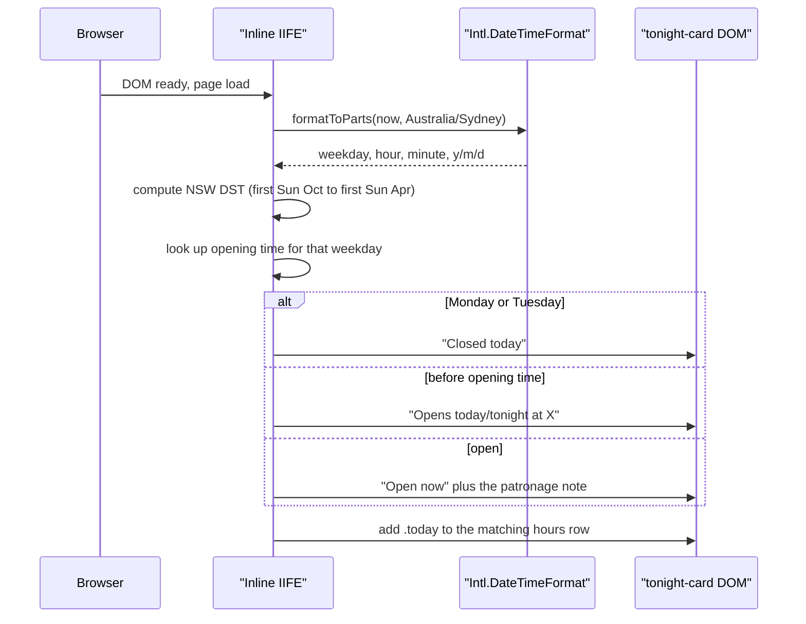

# Sequence Diagrams

## Workflow: Deploy

What happens between editing a file and a visitor seeing it. There is no build step — Pages
serves the repo files directly.

### Walkthrough

1. **Edit** — the author edits a page in [`../../../index.html`](../../../index.html) or a sibling page.
2. **Preview** — served locally per [../getting-started.md](../getting-started.md).
3. **Push** — `main` is the publish branch; the SSH remote is required.
4. **Rebuild** — Pages reprocesses the repo. The HTML has no front matter, so Jekyll passes the
   files through byte-for-byte.
5. **Serve** — `CNAME` binds the custom domain; `hawkinle.github.io` redirects to it.

## Workflow: the "Tonight at the Club" status

The only stateful code on the site. Runs once, on homepage load, in
[`../../../index.html`](../../../index.html) at the end of `<body>`.

### Walkthrough

1. **Read the clock in club time** — `Intl.DateTimeFormat` with `timeZone: 'Australia/Sydney'`,
   so a visitor in another timezone still sees the club's real state rather than their own.
2. **DST test** — compares the club's local date against the first Sunday in October and the
   first Sunday in April.
3. **Schedule lookup** — a small in-file table keyed by weekday, holding an **opening** time
   only. Deliberately no closing time — see [../content-editing.md](../content-editing.md).
4. **Write the status** — headline and sub-line text are set directly. The sub-line always ends
   with the patronage note, because the club never has a defined close.
5. **Highlight today** — `.today` is added to the matching row of the hours list.
